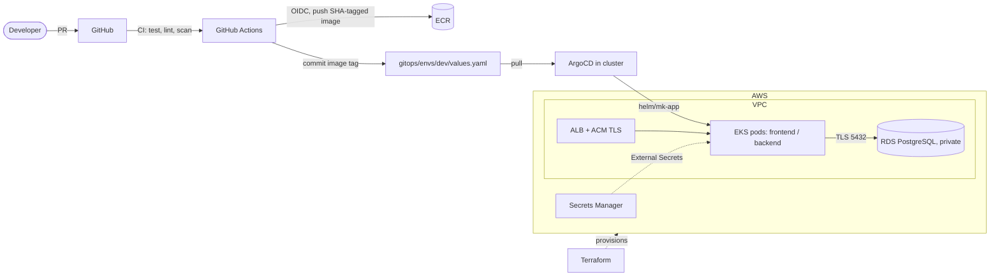

# DevOps mk Platform on AWS EKS

A 3-tier app (React → Flask → PostgreSQL) delivered the way an organisation would run it:
**Terraform** builds AWS, **GitHub Actions** builds/scans/pushes images, **ArgoCD** deploys a **Helm** chart to **EKS** from Git.



## Repository layout

| Path | What it is |
|---|---|
| `app/backend`, `app/frontend` | Application code, hardened multi-stage Dockerfiles, tests, committed DB migrations |
| `helm/mk-app` | The deployable unit. One file per piece: `backend.yaml`, `frontend.yaml` (Deployment + Service + autoscaler + disruption budget each), `ingress.yaml`, `networkpolicy.yaml`, `externalsecret.yaml`, `configmap.yaml`, `migration-job.yaml` |
| `terraform/bootstrap` | Run once: S3 state bucket, ECR, GitHub OIDC provider + roles |
| `terraform/modules` | `platform` (VPC+EKS+RDS+secrets+IAM+ACM), `rds`, `ecr`, `github-oidc`, `pod-identity` |
| `terraform/envs/{dev,prod}` | Thin environment roots: backend config + `terraform.tfvars` |
| `gitops/apps` | ArgoCD "app of apps": a small chart with one file per Application (`mk.yaml`, `external-secrets.yaml`, ...) |
| `gitops/platform`, `gitops/envs` | Values for the add-ons, and per-environment values for the mk app (image tags, sizes) |
| `gitops/bootstrap` | ArgoCD install settings |
| `.github/workflows` | `ci.yml`, `terraform.yml`, `promote.yml` |
| `docs/AUDIT.md` | What was wrong with the original repo and where each fix lives |
| `docs/RUNBOOK.md` | Deploy, operate, roll back, destroy |

## Key design decisions

* **No secrets in Git, ever.** RDS manages its own master password in Secrets Manager; External Secrets syncs it into the pod. Auth to AWS is IAM roles (GitHub OIDC for CI, EKS Pod Identity for controllers).
* **Build once, promote the same image.** Immutable ECR tags (git SHA). CI writes the tag to `gitops/envs/dev`; prod is promoted by PR (`promote.yml`) and a manual ArgoCD Sync.
* **CI never touches the cluster.** ArgoCD pulls. Terraform's AWS role is separate from the image-push role, and apply roles are tied to GitHub *Environments* (put required reviewers on `prod`).
* **No AWS IDs hand-copied.** Terraform prints them as the output `cluster_facts`; `scripts/bootstrap-argocd.sh` puts them into the ArgoCD root app, and the Application files pass them to Helm.
* **Secure by default pods:** non-root, read-only rootfs, dropped capabilities, seccomp, default-deny NetworkPolicy, Pod Security `restricted` namespace, PDBs, topology spread across AZs.

## Naming and labels (one rule everywhere)

* Kubernetes objects have short names: `backend`, `frontend`, `app-config`, `app-secrets`, `migrate`, `mk` (Ingress). The namespace tells you the environment.
* Every object carries the same labels: `app.kubernetes.io/name` (what it is), `app.kubernetes.io/part-of: mk-platform`, `environment` (dev or prod).
* AWS resources carry the same three tags: `Project`, `Environment`, `ManagedBy`.
* Helm values are camelCase and flat: `backend.tag`, `backend.minReplicas`, `config.dbHost`.

## Quick start

Prereqs: AWS admin credentials, `terraform >= 1.10`, `helm`, `kubectl`, `jq`, `docker`, a GitHub repo.

```bash
scripts/set-repo.sh <your-gh-user>/<your-repo>     # point manifests at YOUR repo, then commit + push
cp terraform/bootstrap/terraform.tfvars.example terraform/bootstrap/terraform.tfvars   # edit github_repository
make bootstrap                                      # state bucket + ECR + OIDC roles (once)
# set GitHub repo variables from the bootstrap outputs (see docs/RUNBOOK.md §2), then push to main:
# CI builds + pushes images and records the tag in gitops/envs/dev/values.yaml
make init plan apply ENV=dev                        # VPC, EKS, RDS, IAM (~20 min)
make argocd ENV=dev                                 # installs ArgoCD + the root app; everything else is GitOps
```

